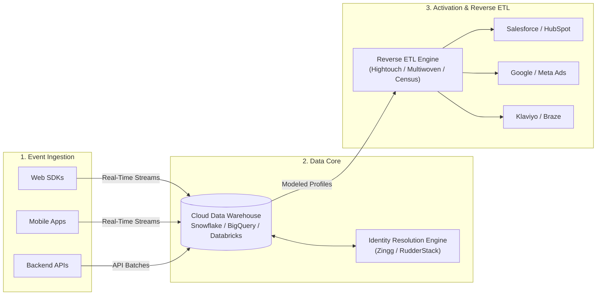

  <strong>⚡ High-Performance Real-Time Customer Data Platform (CDP) Ecosystem, Warehouse-Native Infrastructure, Event Streaming & Reverse ETL ⚡</strong>

  
  
  
  
  
  
  

---

## 📖 Introduction & Ecosystem Overview

Welcome to the **Awesome Real-Time Customer Data Platform (CDP)** repository — the definitive curated directory of **Enterprise SaaS Platforms** and **Self-Hosted Open-Source Frameworks** dedicated to solving the real-time customer data lifecycle. 

In today's omnichannel digital environment, customer expectations require sub-second event ingestion, high-fidelity identity resolution (Customer 360), warehouse-native data governance, and automated omnichannel activation. Whether you are transitioning away from high-MTU legacy vendors to a composable warehouse architecture (Snowflake, BigQuery, Databricks, Redshift, ClickHouse) or standing up an un-metered open-source event collection pipeline, this guide provides actionable comparisons with transparent pricing, free-tier limits, and architectural benchmarks.

---

## 📑 Table of Contents

- [📊 Sector Overview & Market Dynamics](#-sector-overview--market-dynamics)
- [🏢 Enterprise SaaS & Cloud CDP Platforms](#-enterprise-saas--cloud-cdp-platforms)
- [🔓 Open-Source CDP & Data Pipelines](#-open-source-cdp--data-pipelines)
  - [⭐ Open-Source Comparison & Ranking](#-open-source-comparison--ranking)
  - [🔍 Deep-Dive: Open-Source Frameworks](#-deep-dive-open-source-frameworks)
- [🏗️ Architectural Paradigms: Packaged vs Composable CDP](#️-architectural-paradigms-packaged-vs-composable-cdp)
- [❓ Frequently Asked Questions (FAQ)](#-frequently-asked-questions-faq)
- [🤝 How to Contribute](#-how-to-contribute)
- [💖 Support & Sponsorship](#-support--sponsorship)
- [📈 Star History](#-star-history)
- [⚖️ Disclaimer](#️-disclaimer)

---

## 📊 Sector Overview & Market Dynamics

> [!NOTE]
> **Market Size & Velocity**: The global Customer Data Platform (CDP) market is valued at approximately **$8.26 Billion to $10.49 Billion in 2025–2026** and is forecast to surge beyond **$58.4 Billion by 2033**, compounding at an aggressive **CAGR of ~27.8% – 31.2%** *(Sources: Grand View Research, Spherical Insights, CDP Institute)*.

- **Market Structure & Concentration**: The CDP sector exhibits a **dual-structured dynamic**. It is **highly fragmented** across technical architectural models—with fierce competition dividing traditional packaged CDPs, modern composable warehouse-native engines, and developer-centric open-source collection pipes.
- **Enterprise Concentration**: Concurrently, enterprise capital is **moderately concentrated** at the top end, where multi-billion-dollar marketing and cloud conglomerates (Salesforce, Adobe, Twilio) control a large share of Fortune 500 digital transformation budgets. However, high per-MTU lock-in has accelerated developer migration toward **composable Reverse ETL** (Hightouch, Census) and **open-source data sovereignty** (PostHog, RudderStack, Snowplow, Jitsu).

---

## 🏢 Enterprise SaaS & Cloud CDP Platforms

The following enterprise platforms offer managed infrastructure, turnkey SDKs, managed connectors, and out-of-the-box identity resolution graphs.

*Sorted in descending order by company size (Revenue / Market Valuation).*

| 🏢 SaaS Platform | 📈 Company Size (Valuation / Revenue) | 💰 Starting Tier Pricing | 🎁 Free Tier / Trial Limits | 🎯 Core Architecture & Best For |
| :--- | :--- | :--- | :--- | :--- |
| [**Salesforce Data Cloud**](https://www.salesforce.com/data/) | **~$270B+ Valuation** ($34.9B ARR) | **$60,000 / year** ($5,000/mo billed annually for Data 360 Starter SKU; consumption add-on at $500 per 100k flex credits) | **Free Provisioning Tier** with Enterprise/Unlimited CRM editions; includes **250,000 free unified credits/yr**, 1TB data lake foundation, and zero-cost ingestion of native Salesforce CRM data | Enterprise Customer 360, zero-copy data federation with Snowflake/Databricks, and grounding autonomous AI agents (Agentforce). |
| [**Adobe Real-Time CDP**](https://business.adobe.com/products/real-time-customer-data-platform/RT-CDP.html) | **~$250B+ Valuation** ($21.4B ARR) | **$50,000 / year** (Base Prime B2C/B2B tier entry, scaled by addressable active profile tiers; typical enterprise contracts avg ~$200,000+/yr) | **No permanent free tier**; offers a **30-day guided Proof of Concept (PoC)** sandbox via enterprise sales qualification | Large-scale enterprise B2C/B2B marketing, journey orchestration, and deep native integration with Adobe Experience Cloud (AEP). |
| [**Twilio Segment**](https://segment.com/) | **~$11.5B Market Cap** ($4.15B ARR; acquired for $3.2B) | **$120 / month** ($1,440/yr billed annually) for **Team Plan** covering up to 10,000 Monthly Tracked Users (MTUs) and unlimited sources | **Free Forever Tier**: Up to **1,000 MTUs/month**, 2 sources, 1 warehouse destination (1 sync/day), 500,000 Reverse ETL records, and a 14-day trial of Team features | Developer-friendly event routing, 450+ turnkey SaaS destination catalogs, and identity stitching via Segment Unify. |
| [**Fivetran Activations** *(Census)*](https://www.fivetran.com/solutions/reverse-etl) | **~$5.6B Valuation** ($565M+ raised; acquired Census) | **$100 / month** Consumption-based Starter tier for active Reverse ETL destinations and up to 100k Monthly Active Rows (MAR) | **Free Forever Tier**: Up to **500,000 Monthly Active Rows (MAR)**, standard cloud warehouse connectors, plus a **14-day unlimited free trial** of Enterprise features | Composable CDP and Reverse ETL syncing modeled data from Snowflake, BigQuery, Redshift, and Databricks into 200+ business applications. |
| [**Tealium AudienceStream**](https://tealium.com/products/audiencestream/) | **~$1.2B Valuation** ($160M+ venture funding) | **$1,000 / month** ($12,000/yr billed annually) for entry Data Cloud Activation package; full enterprise suites start ~$60,000/yr | **No permanent free tier**; offers a **30-day proof-of-concept (PoC)** sandbox upon technical qualification and sales demo scoping | Real-time client-side tag management (Tealium iQ), server-side event collection (EventStream), and identity resolution. |
| [**Treasure Data**](https://www.treasuredata.com/) | **~$1.0B Valuation** ($234M SoftBank round / acquired for $600M) | **$4,000 / month** ($48,000/yr billed annually for mid-market package; scaled on computational consumption) | **No permanent free tier**; provides a **14-day guided proof-of-concept trial** upon sales consultation with solutions architecture support | High-volume industrial, automotive, and retail data lakes unifying online clickstreams with offline ERP, IoT, and store point-of-sale data. |
| [**mParticle**](https://www.mparticle.com/) | **~$700M Valuation** ($272M+ venture funding) | **$2,500 / month** ($30,000/yr baseline consumption commitment; average annual procurement transactions ~$156,000/yr) | **No permanent free tier**; offers a **30-day guided evaluation sandbox** and custom interactive demo upon sales qualification | Mobile-first consumer apps, native iOS/Android SDK streaming, mobile attribution pipelines (AppsFlyer, Adjust, Branch), and data hygiene. |
| [**Hightouch**](https://hightouch.com/) | **~$615M Valuation** ($80M+ venture funding) | **$350 / month** ($4,200/yr billed annually) for **Starter Plan** with up to 10 active syncs, sub-hourly schedules, and Visual Audience Builder | **Free Forever Tier** (Basic Reverse ETL): Up to **2 active sync configurations**, unlimited destinations, unlimited user seats, and up to 100M operations/mo | The pioneer of Composable CDP: activates warehouse data directly to SaaS destinations with SQL, dbt, or visual segment builders without MTU penalty. |

---

## 🔓 Open-Source CDP & Data Pipelines

Open-source and self-hosted Customer Data Platforms give engineering teams **complete data sovereignty**, eliminate punitive per-MTU billing fees, and ensure adherence to strict compliance regimes (GDPR, CCPA, HIPAA).

### ⭐ Open-Source Comparison & Ranking

*Sorted in descending order by GitHub Star Count.*

| 🌟 Open-Source Repository | ⭐ GitHub Stars | 📜 License | 🛠️ Primary Role in CDP Architecture |
| :--- | :--- | :--- | :--- |
| [**PostHog**](https://github.com/PostHog/posthog) |  | MIT / PostHog Array | Full-stack Product OS, event collection, session replay, user cohorting & warehouse data sync |
| [**Snowplow**](https://github.com/snowplow/snowplow) |  | Snowplow Limited Use (SLUL) / Apache 2.0 | Enterprise-grade behavioral event ingestion, real-time schema validation & data lake loading |
| [**Jitsu**](https://github.com/jitsucom/jitsu) |  | MIT | High-throughput, MIT-licensed event collection and real-time streaming to ClickHouse & warehouses |
| [**RudderStack Server**](https://github.com/rudderlabs/rudder-server) |  | AGPLv3 / Elastic 2.0 | Warehouse-native Customer Data Platform, 100% Segment API compatibility & 200+ integrations |
| [**Multiwoven**](https://github.com/Multiwoven/multiwoven) |  | AGPL-3.0 | Self-hosted Reverse ETL engine connecting cloud warehouses to CRMs, marketing & ad platforms |
| [**Zingg**](https://github.com/zinggAI/zingg) |  | Apache 2.0 | ML-powered identity resolution, entity deduplication, and record linkage for customer 360 |
| [**Grouparoo**](https://github.com/grouparoo/grouparoo) |  | MPL-2.0 | Reverse ETL data synchronization engine bridging SQL databases to marketing destinations |
| [**Tracardi**](https://github.com/Tracardi/tracardi) |  | MIT | API-first, low-code Customer Data Platform with visual workflow orchestration & user profile stitching |
| [**Apache Unomi**](https://github.com/apache/unomi) |  | Apache 2.0 | Official OASIS Customer Data Platform specification reference implementation & rule personalization |
| [**Helio**](https://github.com/achref-soua/helio) |  | AGPL-3.0 | AI-native self-hostable growth platform with embedded CDP, multi-touch attribution & Segment tracking API |
| [**LEO CDP**](https://github.com/trieu/leo-cdp-framework) |  | AGPL-3.0 | Developer framework for AI-driven customer lifetime value (CLV), RFM segmentation & Dagster pipelines |

---

### 🔍 Deep-Dive: Open-Source Frameworks

#### 1. [PostHog](https://github.com/PostHog/posthog) 
- **Architecture**: Comprehensive Product OS and open-source CDP built on ClickHouse and Kafka. Combines event tracking, feature flags, A/B testing, session recording, and customer data warehouse export.
- **Key Capabilities**: Real-time event ingestion, user identity merging, automatic cohort computation, and webhooks to downstream apps.
- **Best For**: Product and engineering teams seeking an all-in-one alternative to Segment, Mixpanel, and LaunchDarkly under their own control.

#### 2. [Snowplow](https://github.com/snowplow/snowplow) 
- **Architecture**: Industrial-grade behavioral data pipeline. Captures rich, strongly-typed JSON/TSV event streams from web, mobile, server, and IoT devices.
- **Key Capabilities**: Sub-second schema validation against Iglu schema registries, real-time data enrichment (GeoIP, IP lookup, user-agent parsing), and streaming loader to Snowflake, Databricks, and BigQuery.
- **Best For**: Data engineering teams requiring bulletproof event validation and custom behavioral modeling within their data lakehouse.

#### 3. [Jitsu](https://github.com/jitsucom/jitsu) 
- **Architecture**: Ultralight, MIT-licensed event collection and ingestion pipeline written in Go and TypeScript.
- **Key Capabilities**: 100% compatible with Segment SDKs; routes raw and transformed event streams directly to ClickHouse, Kafka, Postgres, and cloud warehouses. Built-in bulletproof failover and retry queues.
- **Best For**: Engineering teams requiring a zero-friction, MIT-licensed event collector without vendor lock-in or sales negotiation.

#### 4. [RudderStack Server](https://github.com/rudderlabs/rudder-server) 
- **Architecture**: The leading warehouse-native Segment open-source alternative. Collects, enriches, and synchronizes clickstream events directly into cloud storage and downstream SaaS apps.
- **Key Capabilities**: Segment API-compatible SDKs (swap JavaScript SDK endpoints seamlessly), JavaScript transformation functions, 200+ destination integrations, and native dbt models for identity resolution.
- **Best For**: Data platform teams wanting warehouse-first ownership with effortless migration from Twilio Segment.

#### 5. [Multiwoven](https://github.com/Multiwoven/multiwoven) 
- **Architecture**: Self-hosted Reverse ETL engine built with Ruby on Rails and modern data connectors.
- **Key Capabilities**: Connects to Snowflake, Redshift, BigQuery, and Databricks; pushes modeled customer segments to Salesforce, HubSpot, Klaviyo, Braze, and Slack. Visual mapping interface and dbt model support.
- **Best For**: Teams with an existing modeled data warehouse seeking an open-source, self-hosted alternative to Hightouch and Census.

#### 6. [Zingg](https://github.com/zinggAI/zingg) 
- **Architecture**: Distributed machine-learning entity resolution framework built on Apache Spark.
- **Key Capabilities**: Solves the hardest problem in customer data platforms—probabilistic and fuzzy matching of duplicate user records, incomplete identity graphs, and merged customer accounts.
- **Best For**: Enterprises needing scalable identity stitching across tens of millions of fragmented warehouse rows.

#### 7. [Grouparoo](https://github.com/grouparoo/grouparoo) 
- **Architecture**: Node.js-based open-source Reverse ETL tool (part of the Airbyte ecosystem).
- **Key Capabilities**: Connects directly to relational databases (PostgreSQL, MySQL) and warehouses; defines user properties and calculates calculated cohorts for push synchronization.
- **Best For**: Developers who prioritize Git-driven configuration (code-based models) for CRM syncing.

#### 8. [Tracardi](https://github.com/Tracardi/tracardi) 
- **Architecture**: API-first, composable CDP and workflow automation server backed by Elasticsearch.
- **Key Capabilities**: Low-code visual workflow graph editor for incoming customer events, real-time profile merging, conditional decision trees, and event enrichment microservices.
- **Best For**: Growth marketing and developer teams wanting real-time conditional marketing triggers and visual journey mapping.

#### 9. [Apache Unomi](https://github.com/apache/unomi) 
- **Architecture**: Java-based reference implementation of the OASIS Customer Data Platform standard.
- **Key Capabilities**: Enterprise profile management, built-in consent and privacy compliance lifecycle tracking, real-time rule execution, and native Elasticsearch clustering.
- **Best For**: Organizations prioritizing open industry standardization, strict consent management, and enterprise Java ecosystem alignment.

#### 10. [Helio](https://github.com/achref-soua/helio) 
- **Architecture**: Modern TypeScript-based AI-native growth platform featuring an embedded real-time CDP.
- **Key Capabilities**: Segment/RudderStack HTTP tracking endpoint support, multi-touch attribution (first/last/linear), SQL data explorer, and bring-your-own-AI copilot (OpenAI, Anthropic, Ollama).
- **Best For**: Startups and growth hackers seeking an integrated CDP with automated outbound campaigns and unlimited contacts.

#### 11. [LEO CDP](https://github.com/trieu/leo-cdp-framework) 
- **Architecture**: AI-first customer data platform framework designed for privacy-preserving, on-premises deployment.
- **Key Capabilities**: Omnichannel collection (web, mobile, POS), RFM scoring, predictive customer lifetime value (CLV), churn prediction, and orchestration pipelines with Dagster.
- **Best For**: Data teams requiring local AI-driven scoring models without SaaS data exfiltration.

---

## 🏗️ Architectural Paradigms: Packaged vs Composable CDP

Understanding modern CDP architecture is critical before choosing a vendor:

### 1. Traditional Packaged CDPs (e.g., Twilio Segment, Adobe Real-Time CDP, mParticle)
- **Characteristics**: The vendor hosts their own proprietary database where your customer profiles are built and stored.
- **Pros**: Fast time-to-value for non-technical marketing teams; turnkey integrations out of the box.
- **Cons**: Punitive **Monthly Tracked User (MTU)** pricing that multiplies costs as your userbase expands; creates an isolated data silo outside of your primary enterprise warehouse.

### 2. Composable & Warehouse-Native CDPs (e.g., RudderStack, Hightouch, Multiwoven, Jitsu)
- **Characteristics**: Your cloud data warehouse (Snowflake, BigQuery, Databricks, Redshift) serves as the **Single Source of Truth**. The CDP layer handles event collection and Reverse ETL activation directly out of your modeled tables.
- **Pros**: 100% data ownership, zero vendor data lock-in, unconstrained SQL/dbt data modeling, and up to 80% lower operational costs.
- **Cons**: Requires existing data engineering maturity and warehouse modeling capabilities.

---

## ❓ Frequently Asked Questions (FAQ)

### What is the difference between a CDP and a CRM?
A **Customer Relationship Management (CRM)** platform (like Salesforce Sales Cloud or HubSpot) tracks manual, direct interactions (deals, meetings, customer support tickets) and is primarily human-edited. A **Customer Data Platform (CDP)** unifies millions of real-time behavioral event streams (clicks, pageviews, app transactions, server payloads) across multiple anonymous and known sessions to construct an algorithmic Customer 360 profile.

### Why are organizations switching from Segment to RudderStack or Jitsu?
Twilio Segment's pricing model is pegged to **Monthly Tracked Users (MTUs)**, meaning even anonymous or inactive visitors can trigger expensive tier upgrades. **RudderStack** and **Jitsu** provide Segment-compatible APIs, allowing teams to swap SDK endpoints with zero code refactoring while routing data directly into their own ClickHouse or Snowflake warehouse at a fraction of the cost.

### What is Reverse ETL in a CDP architecture?
Reverse ETL is the process of taking modeled customer data (such as churn risk scores, lifetime value tiers, or high-intent behavioral segments) stored in a central data warehouse and syncing it into operational SaaS tools (CRMs, email marketing platforms, ad networks) where business teams can take immediate action.

---

## 🤝 How to Contribute

Contributions are enthusiastically welcomed! To suggest a new tool or update existing information:

1. 🍴 **Fork** this repository.
2. 🌿 Create a descriptive feature branch (`git checkout -b feature/add-new-cdp-tool`).
3. 📝 Edit `README.md` keeping formatting consistent:
   - Provide verified starting prices (avoid generic "contact sales").
   - Include specific free tier or trial duration parameters.
   - For open-source repos, include the official star badge (`style=social&color=white`) linking to its stargazers page.
4. 🚀 Commit your improvements (`git commit -m "Add New Open-Source CDP"`).
5. 📬 Open a **Pull Request** detailing your additions.

---

## 💖 Support & Sponsorship

If this curated Customer Data Platform guide saved you engineering hours, prevented costly vendor lock-in, or informed your data infrastructure strategy, please consider supporting the project!

- ⭐ **Star this repository** to boost discoverability on GitHub!
- 🍴 **Fork and share** it with your data engineering and growth teams.
- ☕ **Sponsor the Maintainer**: Support ongoing open-source curation and benchmarks via the [**GitHub Sponsors Dashboard**](https://github.com/sponsors/ishandutta2007).

Thank you for championing open, warehouse-native customer data infrastructure! 🙌

---

## 📈 Star History

---

## ⚖️ Disclaimer

- This is an independent, community-curated list compiled for educational, architectural, and evaluation purposes.
- All brand names, logos, product trademarks, and service marks mentioned herein are the property of their respective owners.
- Pricing metrics, trial tiers, and licensing structures are subject to regular vendor changes; please verify directly with each provider's official pricing documentation prior to procurement decisions.
